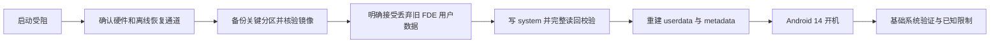

# 最美课本 M1：恢复启动与 Android 14 实践

[English](README.en.md) · [实机配置](docs/device.md) · [全过程](docs/journey.md) · [已知问题](docs/known-issues.md)

把一台启动受阻的最美课本 M1，恢复为可启动的 Android 14 平板。这是**一台实机的工程记录、核验工具与适配经验**，不是厂商固件、通用救砖包或一键刷机工具。

用户已确认目前平板可正常使用；技术记录确认 Android 14 开机完成。这里的“可用”有范围：蓝牙仍有异常记录，长期稳定性、完整硬件兼容和 Android 11 回退尚未完成验证。

## 为什么值得记录

- 静态 system、旧 MTK vendor 和 Linux 4.9 设备，也可能运行较新的 GSI；型号相同不代表硬件修订和分区相同。
- 这次从 Android 11 直接到 Android 14，没有先升级 Android 13。
- 真正的难点包括无法正常使用 fastboot、旧 FDE 数据、底层串口传输、镜像完整性和开机后的基础系统验证。
- 把“用户看到桌面”“工具报告写入成功”“镜像读回一致”和“所有硬件都能用”分开，是这份记录最重要的部分。

## 适用对象

本例为 MT6765 / MT8768T 平台、ARM64、3 GB RAM、VNDK 28、Linux 4.9.117、4 GiB 静态 system 分区的 M1。设备已解锁，当前 vbmeta flags 为 3。**这些条件需要在自己的设备上重新验证，不能照抄分区编号或偏移。**

实测系统来自 [TrebleDroid ci-20240508](https://github.com/TrebleDroid/treble_experimentations/releases/tag/ci-20240508)，是社区实验性 Android 14 GSI，安全补丁为 2024-05-05。它不是截至本项目发布时的最新安全系统，不应把版本号 14 当作安全更新仍在持续的证明。

## 阅读路线

| 内容 | 文档 |
| --- | --- |
| 设备条件、分区与镜像选择 | [实机配置](docs/device.md) |
| 从启动故障到 Android 14 可用的完整经过 | [过程记录](docs/journey.md) |
| 备份、独立恢复通道与回退边界 | [恢复准备](docs/recovery.md) |
| 实际刷写范围、顺序和停止条件 | [刷写流程](docs/flashing.md) |
| 时钟、联网状态、显示与性能检查 | [系统检查](docs/fixes.md) |
| 已确认、未确认和失败项目 | [验证矩阵](docs/known-issues.md) |
| 原始 GSI 的下载地址和本地哈希 | [材料清单](manifests/artifacts.json) |
| 公开范围与问题报告要求 | [隐私与贡献](CONTRIBUTING.md) |



## 仓库提供的工具

Python 3.9+，仅使用标准库。这些工具只读本机文件，不连接平板，不写分区、不清数据，也不修改网络。

```sh
# 支持 raw ext 镜像或 .xz；哈希覆盖展开后的字节
python3 tools/verify_image.py /path/to/system.img.xz \
  --expected-sha256 0c3276a30b0a45b9b87eb629d50d90fb1dafbbb8e556f0b5dd60dcc4ef22d42d

# 输入是自行保存的主 GPT 文件；输出省略磁盘/分区 GUID
python3 tools/gpt_report.py /path/to/gpt-primary.bin

python3 -m unittest discover -s tests -v
```

镜像工具检查长度、XZ 解压、ext 超级块及哈希，**不代替 e2fsck、AVB 信任验证或硬件兼容测试**。正式操作前必须先读恢复和刷写文档。

## 公开范围

本仓库只发布重新整理的文字、自编检查工具和脱敏后的验证摘要。不会提供私人分区备份、userdata、metadata、设备密钥、设备标识、账户或代理订阅；不分发 Android 镜像或应用安装包。

没有任何脚本会对平板自动刷写。历史执行脚本绑定单台设备与授权范围，不能作为可直接推广的安装器。

## 上游项目与许可

感谢 [TrebleDroid](https://github.com/TrebleDroid/treble_experimentations)、[mtkclient](https://github.com/bkerler/mtkclient) 及 AOSP。

本仓库自编代码和文档使用 [MIT License](LICENSE)。上游软件与系统组件仍遵循各自许可；本许可不覆盖它们。
